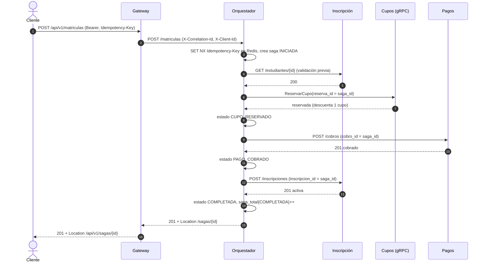
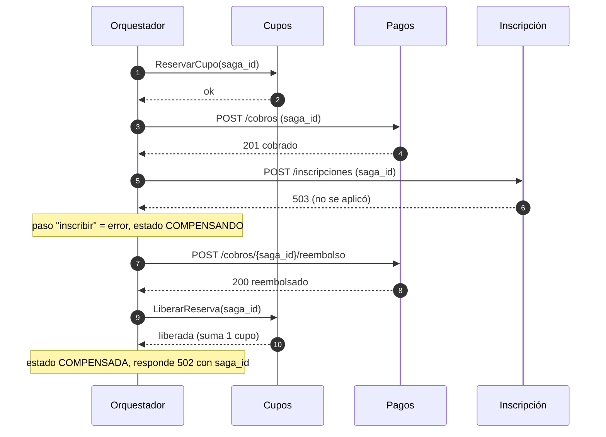
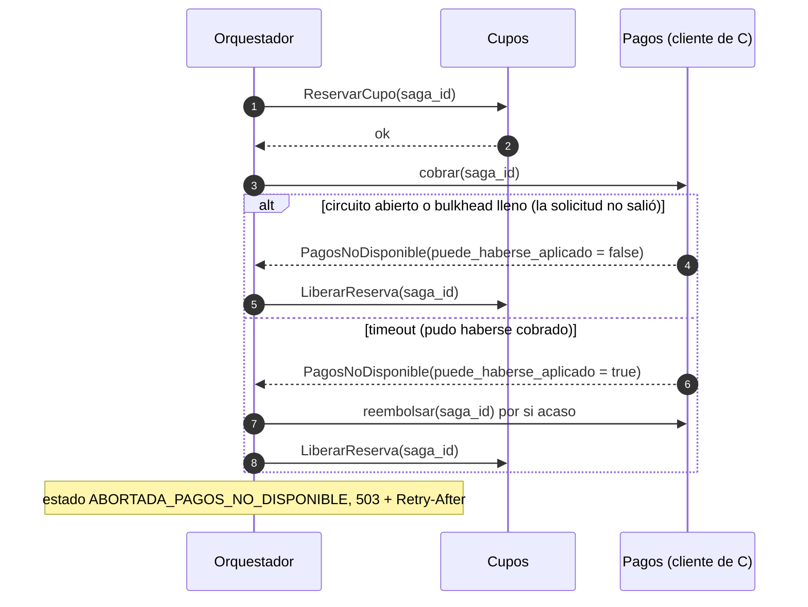
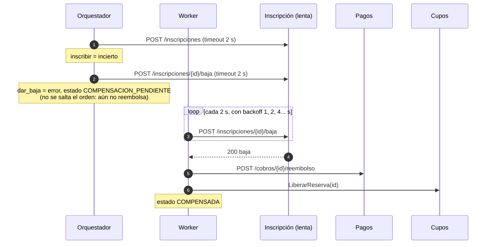
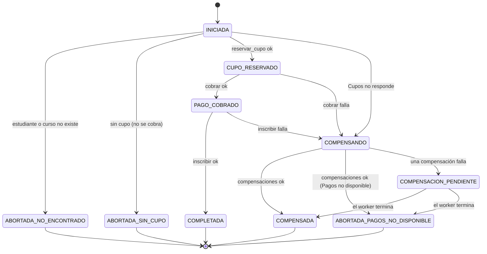

# Diagramas de la Saga de matrícula

Decisión y justificación: [ADR-007](../adr/ADR-007-saga-orquestada.md). Código: `orquestador/app/saga.py`.
GitHub dibuja los bloques `mermaid` directamente; para exportarlos como imagen se puede usar
<https://mermaid.live>.

En todos los casos el `saga_id` viaja como clave idempotente (`reserva_id`, `cobro_id`,
`inscripcion_id`) y cada paso queda registrado en la BD del orquestador antes de seguir.

## 1. Flujo feliz (escenario 1)

## 2. Falla el último paso y se compensa en orden inverso (escenario 2)

Inscripción está caída (`/admin/falla {"caido": true}` responde 503). Un 503 significa que la
operación seguro **no** se aplicó, así que no hace falta darla de baja: se deshacen los pasos 2 y 1.

Si el paso 3 queda **incierto** (timeout), antes de reembolsar se llama también a
`POST /inscripciones/{saga_id}/baja`, que es idempotente y deja una lápida si la inscripción
nunca llegó.

## 3. Pagos no disponible (relación con el escenario 3)

## 4. Una compensación falla y el worker la termina

## 5. Estados de la saga

